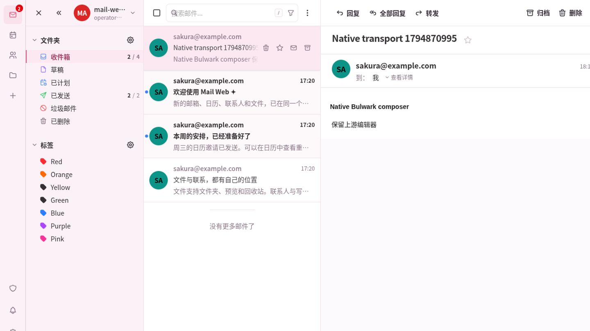

# Mail Web

**Self-hosted Webmail and an operations console for existing Stalwart mail servers.**

*A Rust/Axum service with a statically exported Next.js client and a Rust installation CLI.*

[](https://github.com/reina0721/webmail/actions/workflows/ci.yml)
[](https://github.com/reina0721/webmail/releases)
[](LICENSE)

[简体中文](README_ZH.md) · [Deployment](docs/deployment.md) · [CLI](docs/cli.md) · [Changelog](CHANGELOG.md) · [Contributing](CONTRIBUTING.md)

## Status

Development preview. The release pipeline targets **Linux AMD64 and ARM64**; check the selected Release's attachments for availability. Existing historical releases may only provide AMD64. The [feature matrix](docs/feature-parity.md) and [acceptance boundaries](docs/rebuild-blockers.md) distinguish isolated testing from public production evidence.

Mail Web connects to an existing Stalwart server; it does not install a mail server or configure your DNS, reverse proxy, certificates, or firewall. Public registration is disabled by default.

## Why Mail Web?

- **Your infrastructure and branding.** Configure the site name, mail domains and Stalwart connections in the protected web console.
- **One browser workspace.** Mail, calendars, contacts and files use the Bulwark-derived client, served by Rust.
- **Explicit operations.** The Rust CLI manages installation, diagnostics, updates, consistent backups and restoration.
- **Offline application delivery.** Release bundles contain the application image and CLI; the target server loads the image without compiling source or pulling it from a registry.



Releases pass a fast gate with native builds and actual install, upgrade and restore checks. Full client and sustained business validation then runs against the same published commit; its status and logs appear in the Release notes.

## Quick start

Prerequisites: Linux AMD64/ARM64, Docker Engine, Compose v2, Bash, curl, tar and a SHA-256 tool. Use root or a user already authorized to access Docker. An existing Stalwart service and an HTTPS reverse proxy are needed for normal deployment.

```bash
curl -fsSL https://raw.githubusercontent.com/reina0721/webmail/main/install.sh | bash
```

The interactive installer defaults to `~/apps/mail-web` and `127.0.0.1:18090`. It downloads and verifies Release assets, imports the image, and prints the setup URL. Open the protected console to connect Stalwart and configure your own site.

Unattended installation behind an existing HTTPS reverse proxy:

```bash
curl -fsSL https://raw.githubusercontent.com/reina0721/webmail/main/install.sh | bash -s -- \
  --yes --dir "$HOME/apps/mail-web" --container-name my-webmail \
  --bind 127.0.0.1 --port 18090 --public-origin https://mail.example.org
```

Replace the example origin with your own. The default channel includes prereleases; use `--channel stable` for stable releases or `--version v0.4.0-alpha.4` for an exact version with assets for your architecture. See the [deployment guide](docs/deployment.md), [Stalwart setup](docs/stalwart-setup.md) and [runnable example](examples/install-unattended.sh).

| Method | Intended use | Server behavior |
| --- | --- | --- |
| Release installer | Deploying and updating a site | Verifies downloads, then uses `docker load` |
| Source checkout | Development and isolated verification | Builds Rust and frontend assets locally or in Docker |

## Configuration and maintenance

The CLI configures installation paths, container names and listening addresses. Site branding, Stalwart authorization, domains, accounts, Hooks and Turnstile are configured through `/console/setup/`.

Infrastructure configuration uses the existing [.env.example](.env.example):

```dotenv
MAIL_WEB_VERSION=0.4.0-alpha.4
CONTAINER_NAME=mail-web
LISTEN_ADDRESS=127.0.0.1
PORT=18090
ALLOW_HTTP=false
RELEASE_REPOSITORY=reina0721/webmail
```

The installer generates these settings. Do not put Stalwart administrator credentials in this file. Runtime service credentials are encrypted separately.

```bash
"$HOME/apps/mail-web/mailweb" status --json
"$HOME/apps/mail-web/mailweb" doctor --json
"$HOME/apps/mail-web/mailweb" backup
"$HOME/apps/mail-web/mailweb" setup --show-token
```

The setup token grants administrative access; keep it private. Update and restore procedures are documented in the [CLI guide](docs/cli.md).

## Architecture and repository

```text
backend/            Rust/Axum service, SQLite migrations and OpenAPI contract
crates/mailwebctl/  Rust host installation and maintenance CLI
frontend/           Next.js static client and shared frontend packages
deploy/             Installation, development and isolated test environments
docs/               Deployment guides, upstream records and acceptance evidence
examples/           Unattended installation and infrastructure examples
tests/              Unit, integration and release-install acceptance tests
tooling/            Contract checks, packaging and release guards
.github/            CI, dual-architecture releases and contribution templates
```

Rust serves the exported UI and platform API. SQLite stores platform state; Stalwart stores mail. All components share one versioned repository. [Contributing](CONTRIBUTING.md) covers development checks; [Releasing](docs/releasing.md) covers immutable versions and draft verification.

## Data, security and license

Mail Web communicates with the Stalwart services you configure; registration and human verification can also use external delivery and Cloudflare Turnstile. See [data and security boundaries](docs/deployment.md#7-数据与边界). No claim of zero telemetry or public production readiness is made.

Report ordinary bugs through [Issues](https://github.com/reina0721/webmail/issues). Follow [SECURITY.md](SECURITY.md) for sensitive reports; do not post secrets or mailbox data in public issues.

The repository preserves the existing **AGPL-3.0-only** license and upstream notices. Read [LICENSE](LICENSE), [NOTICE](NOTICE) and the [upstream provenance](docs/upstream/README.md), including the license's existing additional-permission text.
