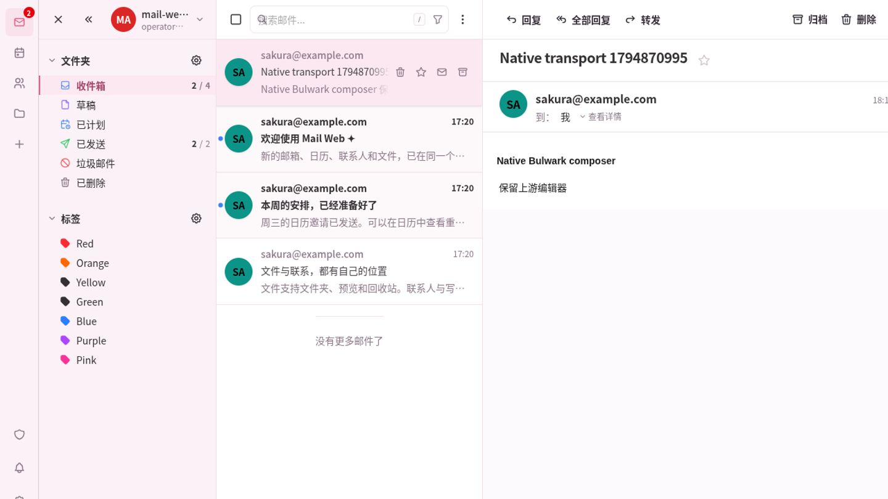

# Mail Web

**面向已有 Stalwart 邮件服务的自托管 Webmail 与运营控制台。**

*Rust/Axum 服务、Next.js 静态客户端，以及 Rust 安装和运维 CLI。*

[](https://github.com/reina0721/webmail/actions/workflows/ci.yml)
[](https://github.com/reina0721/webmail/releases)
[](LICENSE)

[English](README.md) · [部署指南](docs/deployment.md) · [CLI](docs/cli.md) · [变更记录](CHANGELOG.md) · [参与贡献](CONTRIBUTING.md)

## 当前状态

开发预览。发布流水线面向 **Linux AMD64 和 ARM64**；请检查所选 Release 的实际附件。历史版本可能仅提供 AMD64。[功能对照表](docs/feature-parity.md)及[验收边界](docs/rebuild-blockers.md)区分隔离测试与公网生产证据。

Mail Web 连接已有 Stalwart，不负责安装邮件服务器，也不代替你配置 DNS、反代、证书或防火墙。公开注册默认关闭。

## 为什么使用 Mail Web？

- **使用自己的基础设施和品牌。** 在受保护的网页控制台配置站点名称、邮件域名和 Stalwart 连接。
- **统一浏览器工作区。** 基于 Bulwark 的客户端提供邮件、日历、联系人和文件界面，由 Rust 服务提供访问。
- **明确的运维入口。** Rust CLI 管理安装、诊断、升级、一致性备份和恢复。
- **离线交付应用。** Release 包携带应用镜像和 CLI；目标服务器导入镜像，无需编译源码或从镜像仓库拉取。



Release 完成原生构建、版本／架构及附件校验后自动公开；安装、升级、恢复、全量客户端与持续业务测试随后对同一发布提交运行，状态与日志链接显示在 Release 说明中。

## 快速开始

前提：Linux AMD64／ARM64、Docker Engine、Compose v2、Bash、curl、tar 和 SHA-256 工具。使用 root 或已有 Docker 权限的用户。正常部署还需要已有的 Stalwart 服务和 HTTPS 反代。

```bash
curl -fsSL https://raw.githubusercontent.com/reina0721/webmail/main/install.sh | bash
```

交互安装默认使用 `~/apps/mail-web` 和 `127.0.0.1:18090`。安装器下载并校验 Release 附件，导入镜像后输出配置入口。打开受保护的控制台，接入 Stalwart 并配置自己的站点。

已有 HTTPS 反代时的无人值守安装：

```bash
curl -fsSL https://raw.githubusercontent.com/reina0721/webmail/main/install.sh | bash -s -- \
  --yes --dir "$HOME/apps/mail-web" --container-name my-webmail \
  --bind 127.0.0.1 --port 18090 --public-origin https://mail.example.org
```

将示例来源替换为自己的网址。默认渠道包含预发布；仅稳定版使用 `--channel stable`，精确版本可使用 `--version v0.4.0-alpha.4`，但该版本必须提供本机架构的附件。详见[部署指南](docs/deployment.md)、[Stalwart 配置教程](docs/stalwart-setup.md)及[可运行示例](examples/install-unattended.sh)。

| 方式 | 用途 | 服务器行为 |
| --- | --- | --- |
| Release 安装器 | 部署与升级站点 | 校验下载后执行 `docker load` |
| 源码检出 | 开发与隔离验证 | 在本机或 Docker 内构建 Rust 和前端资源 |

## 配置与维护

CLI 配置安装目录、容器名称和监听地址。站点品牌、Stalwart 授权、域名、账号、Hook 和 Turnstile 在 `/console/setup/` 配置。

基础设施参数沿用 [.env.example](.env.example)：

```dotenv
MAIL_WEB_VERSION=0.4.0-alpha.4
CONTAINER_NAME=mail-web
LISTEN_ADDRESS=127.0.0.1
PORT=18090
ALLOW_HTTP=false
RELEASE_REPOSITORY=reina0721/webmail
```

这些设置由安装器生成。不要在此文件中填写 Stalwart 管理员凭据；运行服务凭据会另外加密保存。

```bash
"$HOME/apps/mail-web/mailweb" status --json
"$HOME/apps/mail-web/mailweb" doctor --json
"$HOME/apps/mail-web/mailweb" backup
"$HOME/apps/mail-web/mailweb" setup --show-token
```

配置令牌具有管理权限，请保密。升级与恢复步骤见 [CLI 指南](docs/cli.md)。

## 架构与仓库

```text
backend/            Rust/Axum 服务、SQLite 迁移与 OpenAPI 契约
crates/mailwebctl/  Rust 宿主机安装和维护 CLI
frontend/           Next.js 静态客户端与共享前端包
deploy/             安装、开发及隔离测试环境
docs/               部署指南、上游来源和验收证据
examples/           无人值守安装和基础设施示例
tests/              单元、集成和发布安装验收
tooling/            契约检查、打包与发布门禁
.github/            CI、双架构发布及贡献模板
```

Rust 提供静态 UI 和平台 API。SQLite 保存平台状态，Stalwart 保存邮件。各组件在同一仓库中同步版本。[贡献指南](CONTRIBUTING.md)说明开发检查，[发布指南](docs/releasing.md)说明版本不可变规则及发布校验。

## 数据、安全与许可证

Mail Web 会连接你配置的 Stalwart；注册及人机验证还可能涉及外部邮件投递和 Cloudflare Turnstile。详见[数据和安全边界](docs/deployment.md#7-数据与边界)。项目不宣称零遥测或已经完成公网生产验收。

普通问题通过 [Issues](https://github.com/reina0721/webmail/issues)反馈。敏感问题遵循 [SECURITY.md](SECURITY.md)，不要在公开问题中提交密钥或邮箱数据。

仓库保留现有 **AGPL-3.0-only** 许可证和上游署名。请阅读 [LICENSE](LICENSE)、[NOTICE](NOTICE)及[上游来源](docs/upstream/README.md)，包括现有许可证中的附加许可文本。
