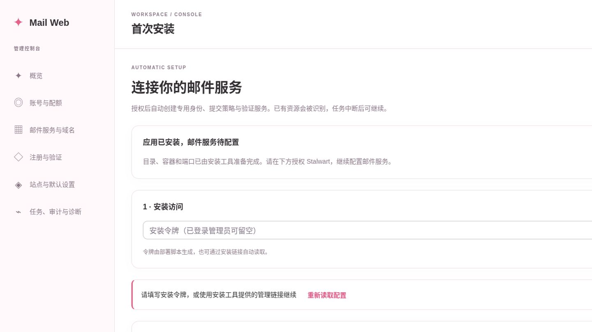

# 一键安装与 Rust CLI 验收记录

验收日期：2026-11-17。范围为本机 Linux AMD64、Docker bridge 和隔离邮件数据；不代表公网生产域名、反垃圾信誉或生产 Turnstile 验收。现有业务容器和主邮件测试栈未被重置。

## 实现及来源

应用、CLI 与发布清单统一为 `v0.4.0-alpha.2`。安装器只处理基础设施，邮件服务仍由 `/console/setup/` 自动配置。DSH 固定基线、适配文件及双许可见 [来源记录](upstream/dsh/README.md)。使用方法和旧版迁移见 [CLI 文档](cli.md)。

## 本机产物回归

通过 `tooling/package-release.sh` 生成实际静态 CLI 与应用镜像归档，安装器校验 SHA-256、`docker load`，核对镜像版本、架构、ID 和提交，再由 Compose 启动。工作树候选包的来源提交标记为基线 `c427573509f515dd3dca0e09266ece5ea2bdee16`，仅用于本地预验收；最终 Release 由 CI 在提交后的准确 SHA 构建和重新验收。

自动化入口：`tests/installer-integration.py`，由 `tests/release-install.sh` 对下载的实际发布产物调用。已完成的候选产物报告保存在忽略目录 `tests/runtime/installer-1794925828/report.json`。

| 项目 | 结果 |
|---|---|
| 根引导、空格目录、真实镜像导入、宿主机 HTTP 与容器健康 | 通过 |
| 重复安装保留所属目录、自定义端口与随机密钥 | 通过；额外回归了已安装 CLI 的目录解析问题 |
| IPv4 回环、通配、指定非回环 IP | 通过 |
| IPv6 回环及旧 `[IPv6]:PORT` 参数 | 通过 |
| 同机独立双实例、自定义名称、旧 `--name` | 通过 |
| 占用端口、冲突参数及外部同名容器 | 明确拒绝，不接管其他服务 |
| 损坏应用归档、下载中断及无 Docker 权限 | 拒绝并保留正常实例 |
| 真实旧 `v0.3.0-alpha.2` Release 与旧 Shell 管理器升级 | 通过；保留名称、端口及安装密钥 |
| 已有隔离账号、注册策略、计数、偏好、提交记录与加密连接配置 | 升级、重复安装和恢复后只读摘要一致 |
| 配置后更改监听未指定 Origin | 拒绝；指定 Origin 后只更新网站来源，Stalwart 字段保留 |
| 一致性备份、恢复、损坏快照拒绝 | 通过；成功恢复撤销旧会话 |
| root 与已有 Docker 权限的普通用户 | 通过；普通用户容器以其非 root UID 运行 |
| 脱敏 JSON、旧入口、任意工作目录与文件日志 | 通过 |
| 管道 + 真实 PTY 的 `/dev/tty` 中文交互 | 通过；实际逐项选择目录、名称、监听和 HTTP 模式 |

共 21 项实际产物回归通过。真实 PTY 管道另验证了非法访问模式重选、同名外部容器重选和占用端口重选；原容器保持健康。对比执行前记录，24 个原有运行容器的 ID 全部保留。

额外注入了备份失败，确认原实例自动恢复运行；并注入校验和备份完成后的 Compose 启动失败：命令返回非零，保留匹配快照，按输出命令恢复后账号、注册策略、发件计数、偏好、提交记录及密钥摘要保持一致。损坏快照在停止服务前即被拒绝。

浏览器观察到安装完成与邮件服务待配置提示，管理链接自动读取令牌并从地址栏移除，未提供令牌时显示准确的安装访问提示。390、768、1024、1440、1920px 页面宽度与文档宽度一致，无水平溢出。

Rust 工作区 46 个后端测试和 14 个 CLI 测试、严格 Clippy、接口契约对比、生成类型、前端类型及架构边界均已通过。完整客户端测试 1169 个文件、10789 个用例全部通过，Docker quality 目标成功完成。实际 Release 下载验收由发布门禁继续核对，未完成的检查不计为通过。

## 发布门禁

CI 先创建草稿，上传镜像、静态 CLI、源码、许可证、安装脚本与校验和，再下载实际草稿产物执行安装和恢复。所有门禁通过后才公开；失败保持草稿，公开版本不可覆盖。

现有完整邮件客户端、双 Stalwart 业务与持续注册测试沿用 CI 原有门禁，本次没有将主测试栈已接近业务名额上限的数据清空以重复测试。
